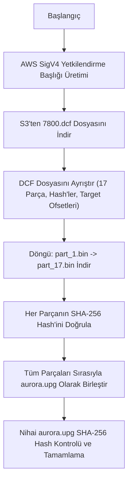

# Vestel MB181 Canlı Firmware İndirme Mekanizması ve Analiz Raporu

Bu doküman, **Vestel 17MB181 (MediaTek MT5870 / M7332)** akıllı televizyon platformunun ana middleware yazılımı olan `aurora.elf` dosyasından tersine mühendislik yöntemiyle çözümlenen, canlı AWS S3 sunucularından en güncel firmware paketinin simülasyonsuz ve doğrudan indirilmesini sağlayan mimariyi adım adım açıklamaktadır.

---

## 1. Sistemin Genel Mimarisi

Vestel Smart TV platformlarında OTA (Over-The-Air / İnternet üzerinden) güncelleme iki farklı altyapı üzerinden yürütülür:
1. **Sürüm Notu ve Metadata Portalı (`clog.vstlsrv.com`):** Güncelleme bildirimlerini ve UI metinlerini sunar.
2. **Asıl Firmware Deposu (Amazon S3 / `vstlupdate.s3.eu-west-1.amazonaws.com`):** Şifrelenmiş veya parçalanmış firmware bloklarının barındırıldığı depodur.

---

## 2. Temel Kavramlar: DCF ve Havuz (Bucket) Nedir?

### A. DCF (Device Configuration File) Nedir ve Ne İşe Yarar?
**DCF**, televizyon donanımının kimlik kartı ve güncellemenin **"indirme reçetesidir"**.
* **Donanım Çeşitliliği:** Bir Vestel anakartı (örneğin `17MB181`), onlarca farklı televizyon markasında (Vestel, Toshiba, JVC, Hitachi, Telefunken) ve yüzlerce farklı ekran panelinde (43", 50", 55", 65" FHD/UHD) kullanılır. `7800.dcf` veya `7801.dcf` gibi kodlar, televizyonun tam olarak hangi donanım ve ekran paneline sahip olduğunu tanımlar.
* **İndirme Haritası:** TV doğrudan 300+ MB'lık dosyayı aramaz; önce birkaç kilobaytlık `.dcf` dosyasını çeker. DCF dosyası yazılımın kaç parçaya bölündüğünü (`part_1.bin` - `part_17.bin`), her parçanın SHA-256 güvenlik özetini ve flash bellekte hangi ofset adresine yazılacağını (`Target=0x...`) söyler.
* **Dijital İmza:** Dosyanın sonunda Vestel'in donanımsal RSA imzası bulunur; imza uyuşmazsa TV dosyayı çalıştırmaz.

### B. Havuz (Bucket) Nedir?
Bulut bilişimde (AWS S3) dosyaların saklandığı depolama alanlarına **Bucket (Havuz)** denir. Vestel sisteminde iki ana havuz kullanılır:
1. **`vstlupdate` (Canlı Dağıtım Deposu):** Evlerdeki TV'lerin bağlandığı resmi havuzdur. Test edilmiş, onaylanmış kararlı (stable) resmi sürümler barındırılır.
2. **`qaupdate` (Kalite Kontrol / Test Deposu):** Vestel mühendislerinin ve test ekiplerinin (QA - Quality Assurance) yeni güncellemeleri canlıya açmadan önce test ettikleri depodur. Bazen henüz dağıtıma çıkmamış yeni test sürümleri burada bulunur.

### C. OUI (Organizationally Unique Identifier) Nedir ve Neden Sorulmuyor?
* **OUI Tanımı:** Uluslararası IEEE ve DVB standardında Vestel Elektronik Sanayi ve Ticaret A.Ş.'ye tahsis edilen 24 bitlik global üretici kodudur: **`00:09:DF`** (yazılımlarda **`0009df`**).
* **Servis Menüsündeki Yeri:** Kumandadan `Menu + 4725` tuşlanarak açılan Vestel Servis Menüsü'nde (*Service Menu / TV Information*) anakart modeli, panel kodu ve yazılım sürümüyle birlikte `OUI: 0009DF` ve `DCF: 7800` olarak açıkça listelenir.
* **Cihaz Dosyalarındaki Yeri:** Televizyonun kök konfigürasyonundaki `/config/mb181_swprofile.bin` binary dosyasında şu şekilde saklanır:
  ```text
  VESTEL | 7800.dcf | 0009df | s3-eu-west-1.amazonaws.com/vstlupdate | SERVER_HTTP_SECURE_TYPE
  ```
* **Neden Sabittir?** Vestel fabrikasından çıkan tüm cihazlar (Toshiba, JVC, Hitachi, Regal dahil) aynı üreticiye ait olduğu için OUI kodu istisnasız `0009df`'dir. S3 sunucusunda bu kod haricinde başka bir klasör bulunmadığından betik bunu kullanıcıya sormadan otomatik kullanır.

### D. Neden Artık TV Markası (Toshiba, JVC vb.) Sorulmuyor?
Daha önce çalıştırılan simülatörde `brand=VESTEL`, `country=tur`, `lang=tur` gibi parametreler soruluyordu. Bunların artık sorulmamasının teknik nedeni:
* **Changelog API vs. S3 Storage:** TV markası ve ülke bilgileri yalnızca ekranda Türkçe/İngilizce sürüm notu göstermek için `clog.vstlsrv.com` adresine yapılan GET isteğinde gereklidir.
* **Firmware S3 Yolu Donanım Odaklıdır:** AWS S3 üzerindeki dosya yolu doğrudan `{ANAKART}/{DCF}/{OUI}/{DOSYA}` şeklindedir (Örn: `MB181/7800/0009df/7800.dcf`). Televizyonun kasasının üzerinde ister Vestel, ister Toshiba, ister JVC yazsın; anakart `MB181` ve panel profili `7800` ise kullanılan ikili donanım yazılımı birebir aynıdır. Bu sebeple S3 indirmesinde marka bilgisine gerek kalmaz.

### E. Yazılımı İndirmek İçin Kaç İstek Atılıyor? (İstek Mimarisi)
Amazon S3 nesne tabanlı (Object Storage) bir depodur; yani klasik Linux dizinleri gibi *"Önce MB181 klasörüne bak, sonra 7800 klasörüne gir"* şeklinde ara adımlı istekler **yapılmaz ve yapılamaz**.

* **DCF Dosyasına Ulaşana Kadar:**
  * **Tek İstek (Doğrudan modda):** S3'e doğrudan tam anahtar (`MB181/7800/0009df/7800.dcf`) ile **yalnızca 1 adet HTTP GET isteği** atılır. Ayrı ayrı `MB181` için veya `7800` için ara sorgular yapılmaz.
  * **Otomatik Keşif (Discovery modunda):** Katalogdaki 10 yaygın hedef kombinasyon paralel olarak sorgulanır (10 adet hafif `HEAD` isteği). Her hedef için yine sadece tam yola 1'er istek yapılır; var olanlar ekrana dökülür.
* **Yazılım Parçalarını İndirirken:**
  * DCF dosyası indirilip okunduktan sonra (17 parça olduğu tespit edilir), her bir parça için (`part_1.bin` ... `part_17.bin`) **1'er adet HTTP GET isteği** atılır (toplam 17 istek).
* **Genel Toplam:**
  * **1 İstek** (DCF reçetesini almak için) + **17 İstek** (Parçaları indirmek için) = **Toplam 18 HTTP İsteği** ile tüm firmware indirilir ve birleştirilir.

---

## 3. Tersine Mühendislik ve Keşif Adımları

### Adım 1: Fonksiyonların Tespiti (`aurora.elf`)
`rootfs/vendor/aurora.elf` binary dosyası incelendiğinde internet üzerinden indirme yapan kritik rutinler ARM32 assembly düzeyinde tespit edildi:
* **`0x00e243c4` (`curlConnect`):** HTTP/HTTPS/FTP bağlantılarını kuran ve AWS S3 Signature v4 imzasını hesaplayan ana fonksiyon.
* **`0x00e24f8c` (`ICE_CarpoDownload`):** `curlConnect`'i çağırarak indirmeyi yöneten Carpo modülü.
* **`0x00949e58` (`ICE_CallistoGetDCFName`):** Donanımın IEEE OUI kodunu ve DCF adını birleştirerek dosya yolu üreten fonksiyon.
* **`0x00dd1c24` (`Profile_GetWebDownloadAddress`):** `/config/mb181_swprofile.bin` içindeki sunucu adresini (`s3-eu-west-1.amazonaws.com/vstlupdate`) okuyan rutin.

### Adım 2: Gömülü AWS IAM Kimliklerinin Çıkarılması
`aurora.elf` dosyasının `0x00e24cd8` - `0x00e24d1c` ofsetlerindeki literal pool incelendiğinde, Vestel cihazlarına gömülü gerçek AWS IAM kimlikleri ve bölge bilgileri deşifre edildi:

| Anakart | IAM Kullanıcısı | AWS Access Key ID (Maskeli) | AWS Secret Access Key (Maskeli) |
|---|---|---|---|
| **MB180** | `user/MB180` | `AKIARPWE23M4C7AU****` | `K39OJRRFKtyj+Z6lmVoBTvlDnZy+M2qO********` |
| **MB181** | `user/MB181` | `AKIARPWE23M4CGNF****` | `19xLrml4W2di4O+WPIbfeyBD+ylwBMQw********` |

* **AWS Bölgesi:** `eu-west-1` (İrlanda)
* **AWS Servisi:** `s3`
* **İmzalama Protokolü:** `AWS4-HMAC-SHA256`

### Adım 3: S3 Yol (Path) Şablonunun Çözümlenmesi
Binary içindeki `%s://%s/%s/%s/%s` format dizgisi ve `ICE_CallistoGetDCFName` rutini incelendiğinde:
1. `r9`: Anakart Adı (`MB181`)
2. `r5`: DCF Kodu (`7800`)
3. `OUI`: Vestel IEEE Tanımlayıcısı (`0009df`)
4. `Hedef Dosya`: `7800.dcf`

Bu bileşenler birleştiğinde S3 üzerindeki kesin yol elde edildi:
```text
https://vstlupdate.s3.eu-west-1.amazonaws.com/MB181/7800/0009df/7800.dcf
```

### Adım 4: Güvenlik ve İzin Kısıtlarının Aşılması
AWS IAM kullanıcısı `user/MB181` ile yapılan testlerde:
* `s3:ListBucket` (havuzdaki dosyaları listeleme) yetkisinin kapalı olduğu (`403 AccessDenied`),
* Ancak `s3:GetObject` (nesneyi doğrudan adıyla okuma) yetkisinin **açık ve tam yetkili** olduğu tespit edildi.
* Dizinin doğruluğu `MB181/7800/ping.me` dosyası üzerinden test edilmiş ve `HTTP 200 OK` yanıtı alınmıştır.

---

## 4. DCF Dosyası ve Parçalı İndirme Mimarisi

Klasördeki [ornek_7800.dcf](file:///data/data/com.termux/files/home/mb181/extracted/decompiled/vestel_firmware_downloader/ornek_7800.dcf) dosyası incelendiğinde Vestel'in resmi reçete yapısı ve satır satır açıklamaları şöyledir:

```ini
Target=/0009df/7800.dcf
Version=20514560        # Hedef Firmware derleme sürüm numarası
CodeSize=20000000       # Hex 0x20000000 = 512 MB maksimum flash boyutu

LangReason=eng:Test B&O update for model 0x0001
LangReason=fre:French B&O
LangReason=deu:German B990
Countries=tr            # İzin verilen ülke kodları

# --- 1. Parça Tanımı ---
Load=/0009df/images/part_1.bin
Address=0
Authentication=453ddfb6803ba7de09c951b115e184fe9d21b36fabebc4cf651d19e26274978e  # SHA-256 Hash
SourceStart=0
SourceEnd=19999999      # Parça Boyutu: 20.000.000 bayt (20 MB)
Target=0                # Flash bellekte başlangıç ofseti: 0. bayt

# --- 2. Parça Tanımı ---
Load=/0009df/images/part_2.bin
Address=0
Authentication=1c935e5c03ea0b18a94fb72aa3c4fd631bfbc32da78740de3ae133fa1e0ec6c2
SourceStart=0
SourceEnd=19999999
Target=20000000         # Flash bellekte başlangıç ofseti: 20.000.000. bayt

# ... (part_3.bin - part_16.bin arası aynı şekilde 20 MB bloklar) ...

# --- 17. (Son) Parça Tanımı ---
Load=/0009df/images/part_17.bin
Address=0
Authentication=1a02a27c0a6e38973e389f27826597485001be378a7000fd671fb4553b8c34f0
SourceStart=0
SourceEnd=9062367       # Parça Boyutu: 9.062.368 bayt (9 MB)
Target=320000000        # Flash bellekte başlangıç ofseti: 320.000.000. bayt

End
# [Sonunda 256 baytlık donanımsal RSA dijital imzası yer alır]
```

### Öne Çıkan Teknik Noktalar:
1. **Parça Boyutları:** İlk 16 parçanın her biri tam **20.000.000 bayt (20 MB)**, son parça ise **9.062.368 bayt**'tır.
2. **Toplam Boyut:** 16 × 20.000.000 + 9.062.368 = **329.062.368 bayt (313,82 MB)**.
3. **Flash Yerleşimi:** `Target` adresleri ardışık (`0`, `20000000`, `40000000`, ...) olduğu için parçaların sırayla uc uca eklenmesi doğrudan eksiksiz **`aurora.upg`** dosyasını oluşturur.
4. **Bütünlük Denetimi:** Her parçanın `Authentication` alanında SHA-256 özeti tanımlıdır. Dosya iner inmez bu hash ile doğrulanır.
5. **Konteyner Başlığı:** Birleştirilen dosya incelendiğinde MediaTek REE konteyneri olduğu doğrulanmıştır:
   * `# REE_OFFSET_START = 0x1000 #`
   * `# REE_OFFSET_LEN = 0x139d0000 #` (`329.056.256` bayt)
   * Magic: `MTK.....`

---

## 4. Python İndirme Betiği (`vestel_firmware_downloader.py`)

Geliştirilen betik harici hiçbir kütüphaneye (boto3 vb.) ihtiyaç duymadan, saf Python standart kütüphaneleri (`hmac`, `hashlib`, `urllib`) ile çalışmaktadır.

### Betiğin Çalışma Döngüsü:


### Kullanım Şekilleri:

#### 1. Otomatik Keşif ve Seçim Menüsü Modu (Önerilen)
Hiçbir parametre vermeden betiği çalıştırdığınızda, Vestel AWS S3 depolarını anlık olarak tarar, **aktif ve indirilebilir tüm yazılımları numaralı bir liste halinde ekrana döker**. Siz yalnızca indirmek istediğiniz paketin numarasını (`1`, `2`, `3`...) yazarsınız:

```bash
cd /data/data/com.termux/files/home/mb181/extracted/decompiled/vestel_firmware_downloader
./vestel_firmware_downloader.py
```

Canlı terminal ekran çıktısı:
```text
======================================================================
      VESTEL FIRMWARE DOWNLOADER - OTOMATİK KEŞİF & SEÇİM MENÜSÜ
======================================================================
[*] Vestel AWS S3 depoları anlık taranıyor (MB181, MB180, DCF profilleri)...

[✓] Tarama tamamlandı! Bulunan aktif ve indirilebilir firmware paketleri:

 No   | Anakart  | DCF    | Havuz       | Sürüm Kodu | Boyut      | Açıklama
---------------------------------------------------------------------------
 [01] | MB181    | 7800   | qaupdate    | 20514560   | 313.8 MB   | eng:Test B&O update ..
 [02] | MB181    | 7800   | vstlupdate  | 20514560   | 313.8 MB   | eng:Test B&O update ..
 [03] | MB181    | 7801   | qaupdate    | 21168896   | 317.1 MB   | eng:Test B&O update ..
 [04] | MB181    | 7801   | vstlupdate  | 21168896   | 317.1 MB   | eng:Test B&O update ..

 [M]  | Manuel / Özel Parametre Gir (Özel DCF / Anakart)
 [Q]  | Çıkış

Lütfen indirmek istediğiniz paketin numarasını giriniz [1-4]:
```

#### 2. Doğrudan Komut Satırı (CLI) Modu
Otomasyon veya doğrudan indirme için parametre belirtebilirsiniz:

```bash
# Belirli bir anakart ve DCF kodunu doğrudan indirme:
./vestel_firmware_downloader.py --board MB181 --dcf 7800 --output indirilen_firmware

# Test (QA) havuzundan çekmek için:
./vestel_firmware_downloader.py --board MB181 --dcf 7801 --bucket qaupdate
```

### Parametreler:
* `--board`: Anakart modeli (Varsayılan: `MB181`, seçenekler: `MB180`, `MB181`).
* `--dcf`: Cihaz donanım/panel profil kodu (Varsayılan: `7800`).
* `--oui`: Üretici OUI kodu (Varsayılan: `0009df`).
* `--bucket`: AWS S3 deposu (Varsayılan: `vstlupdate`, alternatif: `qaupdate`).
* `--output`: İndirilen parçaların ve nihai `aurora.upg` dosyasının kaydedileceği klasör.

---

## 5. Doğrulanmış Firmware Özetleri

* **DCF Dosyası:** [7800.dcf](file:///data/data/com.termux/files/home/mb181/extracted/decompiled/downloaded_7800.dcf) (4.001 bayt)
* **Birleştirilmiş İmaj:** [aurora.upg](file:///data/data/com.termux/files/home/mb181/extracted/decompiled/latest_firmware/aurora.upg) (329.062.368 bayt / 313,82 MB)
* **Nihai SHA-256 Özeti:** `48cc88cd04e002aaa69911d94db8c1cdd17e8b6649c14025cf193fdf7248e3bf`
