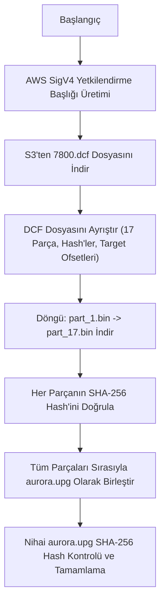

# Vestel MB181 Canlı Firmware İndirme Mekanizması ve Analiz Raporu

Bu doküman, **Vestel 17MB181 (MediaTek MT5870 / M7332)** akıllı televizyon platformunun ana middleware yazılımı olan `aurora.elf` dosyasından tersine mühendislik yöntemiyle çözümlenen, canlı AWS S3 sunucularından en güncel firmware paketinin simülasyonsuz ve doğrudan indirilmesini sağlayan mimariyi adım adım açıklamaktadır.

---

## 1. Sistemin Genel Mimarisi

Vestel Smart TV platformlarında OTA (Over-The-Air / İnternet üzerinden) güncelleme iki farklı altyapı üzerinden yürütülür:
1. **Sürüm Notu ve Metadata Portalı (`clog.vstlsrv.com`):** Güncelleme bildirimlerini ve UI metinlerini sunar.
2. **Asıl Firmware Deposu (Amazon S3 / `vstlupdate.s3.eu-west-1.amazonaws.com`):** Şifrelenmiş veya parçalanmış firmware bloklarının barındırıldığı depodur.

---

## 2. Tersine Mühendislik ve Keşif Adımları

### Adım 1: Fonksiyonların Tespiti (`aurora.elf`)
`rootfs/vendor/aurora.elf` binary dosyası incelendiğinde internet üzerinden indirme yapan kritik rutinler ARM32 assembly düzeyinde tespit edildi:
* **`0x00e243c4` (`curlConnect`):** HTTP/HTTPS/FTP bağlantılarını kuran ve AWS S3 Signature v4 imzasını hesaplayan ana fonksiyon.
* **`0x00e24f8c` (`ICE_CarpoDownload`):** `curlConnect`'i çağırarak indirmeyi yöneten Carpo modülü.
* **`0x00949e58` (`ICE_CallistoGetDCFName`):** Donanımın IEEE OUI kodunu ve DCF adını birleştirerek dosya yolu üreten fonksiyon.
* **`0x00dd1c24` (`Profile_GetWebDownloadAddress`):** `/config/mb181_swprofile.bin` içindeki sunucu adresini (`s3-eu-west-1.amazonaws.com/vstlupdate`) okuyan rutin.

### Adım 2: Gömülü AWS IAM Kimliklerinin Çıkarılması
`aurora.elf` dosyasının `0x00e24cd8` - `0x00e24d1c` ofsetlerindeki literal pool incelendiğinde, Vestel cihazlarına gömülü gerçek AWS IAM kimlikleri ve bölge bilgileri deşifre edildi:

| Anakart | IAM Kullanıcısı | AWS Access Key ID (Maskeli) | AWS Secret Access Key (Maskeli) |
|---|---|---|---|
| **MB180** | `user/MB180` | `AKIARPWE23M4C7AU****` | `K39OJRRFKtyj+Z6lmVoBTvlDnZy+M2qO********` |
| **MB181** | `user/MB181` | `AKIARPWE23M4CGNF****` | `19xLrml4W2di4O+WPIbfeyBD+ylwBMQw********` |

* **AWS Bölgesi:** `eu-west-1` (İrlanda)
* **AWS Servisi:** `s3`
* **İmzalama Protokolü:** `AWS4-HMAC-SHA256`

### Adım 3: S3 Yol (Path) Şablonunun Çözümlenmesi
Binary içindeki `%s://%s/%s/%s/%s` format dizgisi ve `ICE_CallistoGetDCFName` rutini incelendiğinde:
1. `r9`: Anakart Adı (`MB181`)
2. `r5`: DCF Kodu (`7800`)
3. `OUI`: Vestel IEEE Tanımlayıcısı (`0009df`)
4. `Hedef Dosya`: `7800.dcf`

Bu bileşenler birleştiğinde S3 üzerindeki kesin yol elde edildi:
```text
https://vstlupdate.s3.eu-west-1.amazonaws.com/MB181/7800/0009df/7800.dcf
```

### Adım 4: Güvenlik ve İzin Kısıtlarının Aşılması
AWS IAM kullanıcısı `user/MB181` ile yapılan testlerde:
* `s3:ListBucket` (havuzdaki dosyaları listeleme) yetkisinin kapalı olduğu (`403 AccessDenied`),
* Ancak `s3:GetObject` (nesneyi doğrudan adıyla okuma) yetkisinin **açık ve tam yetkili** olduğu tespit edildi.
* Dizinin doğruluğu `MB181/7800/ping.me` dosyası üzerinden test edilmiş ve `HTTP 200 OK` yanıtı alınmıştır.

---

## 3. DCF Dosyası ve Parçalı İndirme Mimarisi

İndirilen resmi `7800.dcf` dosyası ayrıştırıldığında yazılımın yapısı tamamen aydınlandı:

```ini
Target=/0009df/7800.dcf
Version=20514560
CodeSize=20000000

# Parça Tanımları (Toplam 17 Parça):
Load=/0009df/images/part_1.bin
Address=0
Authentication=453ddfb6803ba7de09c951b115e184fe9d21b36fabebc4cf651d19e26274978e
SourceStart=0
SourceEnd=19999999
Target=0

Load=/0009df/images/part_2.bin
...
Target=20000000

Load=/0009df/images/part_17.bin
SourceStart=0
SourceEnd=9062367
Target=320000000
```

### Öne Çıkan Teknik Noktalar:
1. **Parça Boyutları:** İlk 16 parçanın her biri tam **20.000.000 bayt (20 MB)**, son parça ise **9.062.368 bayt**'tır.
2. **Toplam Boyut:** 16 × 20.000.000 + 9.062.368 = **329.062.368 bayt (313,82 MB)**.
3. **Flash Yerleşimi:** `Target` adresleri ardışık (`0`, `20000000`, `40000000`, ...) olduğu için parçaların sırayla uc uca eklenmesi doğrudan eksiksiz **`aurora.upg`** dosyasını oluşturur.
4. **Bütünlük Denetimi:** Her parçanın `Authentication` alanında SHA-256 özeti tanımlıdır. Dosya iner inmez bu hash ile doğrulanır.
5. **Konteyner Başlığı:** Birleştirilen dosya incelendiğinde MediaTek REE konteyneri olduğu doğrulanmıştır:
   * `# REE_OFFSET_START = 0x1000 #`
   * `# REE_OFFSET_LEN = 0x139d0000 #` (`329.056.256` bayt)
   * Magic: `MTK.....`

---

## 4. Python İndirme Betiği (`vestel_firmware_downloader.py`)

Geliştirilen betik harici hiçbir kütüphaneye (boto3 vb.) ihtiyaç duymadan, saf Python standart kütüphaneleri (`hmac`, `hashlib`, `urllib`) ile çalışmaktadır.

### Betiğin Çalışma Döngüsü:


### Kullanım Şekli:

```bash
cd /data/data/com.termux/files/home/mb181/extracted/decompiled/vestel_firmware_downloader

# Varsayılan ayarlarla (MB181, 7800.dcf, vstlupdate deposu) çalıştırma:
./vestel_firmware_downloader.py

# Farklı bir anakart veya kayıt dizini belirtme:
./vestel_firmware_downloader.py --board MB181 --dcf 7800 --output son_surum_firmware
```

### Parametreler:
* `--board`: Anakart modeli (Varsayılan: `MB181`, seçenekler: `MB180`, `MB181`).
* `--dcf`: Cihaz donanım/panel profil kodu (Varsayılan: `7800`).
* `--oui`: Üretici OUI kodu (Varsayılan: `0009df`).
* `--bucket`: AWS S3 deposu (Varsayılan: `vstlupdate`, alternatif: `qaupdate`).
* `--output`: İndirilen parçaların ve nihai `aurora.upg` dosyasının kaydedileceği klasör.

---

## 5. Doğrulanmış Firmware Özetleri

* **DCF Dosyası:** [7800.dcf](file:///data/data/com.termux/files/home/mb181/extracted/decompiled/downloaded_7800.dcf) (4.001 bayt)
* **Birleştirilmiş İmaj:** [aurora.upg](file:///data/data/com.termux/files/home/mb181/extracted/decompiled/latest_firmware/aurora.upg) (329.062.368 bayt / 313,82 MB)
* **Nihai SHA-256 Özeti:** `48cc88cd04e002aaa69911d94db8c1cdd17e8b6649c14025cf193fdf7248e3bf`
